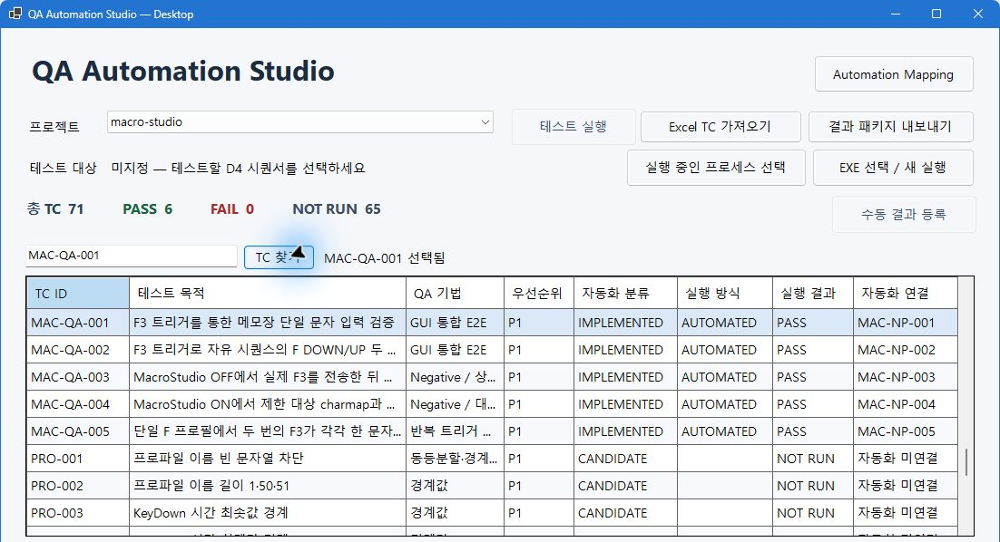

# QA Automation Studio

[포트폴리오 PDF 열람](portfolio/QA_Automation_Studio_Portfolio.pdf)

Windows 데스크톱 테스트의 설계, 실행, 판정과 증적을 연결하는 C# WinForms 프로젝트입니다. 공개본은 Sprint 4.1의 로컬 검증 완료 소스를 바탕으로 구성했습니다.



## Project Overview

Excel로 작성한 TC를 프로젝트별로 등록하고, 자동화 또는 수동 실행 결과를 SQLite에 기록합니다. 결과 Excel에서 TC별 최신 판정과 개별 Run을 조회하고, Run ID로 증적을 확인할 수 있습니다.

## QA Engineering Objectives

- 사전조건·입력·기대 결과를 TC에 명시해 판정 기준을 재현할 수 있게 합니다.
- 매핑, 실행 이력, 최신 상태, 수동 준비도를 각각 추적합니다. 가져온 Excel의 판정 텍스트로 실행 이력을 생성하지 않습니다.
- 실제 관찰값과 판정 근거를 보존하고, 내보낸 증적을 SHA-256으로 대조합니다.

## Technology Stack

C# · .NET 10 · WinForms · SQLite schema v6(`winsqlite3.dll`) · Excel OOXML · JSON · Windows UI Automation · Win32 SendInput

## Architecture

WinForms가 작업을 요청하고 Application이 실행과 결과 패키지 생성을 조정합니다. Domain은 TC와 결과 모델을 정의하고 Infrastructure는 SQLite 영속성, Adapters는 Excel과 Windows 프로세스·창 접근을 담당합니다. [아키텍처와 실행 흐름](docs/ARCHITECTURE.md)

## Key Features

- 프로젝트별 TC 검색, Excel 가져오기 미리보기, 필수 항목·중복 검증
- Automation Mapping 조회·저장·해제, 연결 TC 자동 실행, 기본 Smoke Test
- 수동 결과와 첨부 등록, 자동·수동 실행 이력 조회용 Excel 및 증적 패키지
- 마스터와 결과 Excel에서 명시적 매핑 또는 기본 Smoke Test가 있으면 `자동 실행 가능 여부`를 `예`로 표시합니다. 실제 SUT 준비 상태는 실행 시 확인합니다.

## Test Design Techniques

| 기법 | 대표 TC | 기대 결과 |
| --- | --- | --- |
| 경계값 | `PRO-002` | 프로파일 이름 1·50자 허용, 51자 거부 |
| 결정 테이블 | `MAC-003` | 매크로 OFF에서 F3 입력 0회, 엔진 정지 |
| 상태 전이 | `MAC-001` | 최초 실행 시 OFF, 단축키 감시 비활성 |
| 동등 분할 | `AUD-002` | 사용자 정의 분·초 치환값이 올바르게 표시됨 |

[대표 TC의 검증 조건과 설계 근거](docs/TEST_DESIGN.md)

## Automation Scenarios

| TC | 시나리오 | 실제 관찰 |
| --- | --- | --- |
| `MAC-QA-001` | `MAC-NP-001` | F3 1회 후 `f`, 2초 이상 유지 |
| `MAC-QA-002` | `MAC-NP-002` | F3 1회 후 `ff`, 2초 이상 유지 |
| `MAC-QA-003` | `MAC-NP-003` | 매크로 OFF에서 F3 후 빈 문서 2,603 ms 유지 |
| `MAC-QA-004` | `MAC-NP-004` | 허용 대상 불일치 상태에서 F3 후 빈 문서 3,472 ms 유지 |
| `MAC-QA-005` | `MAC-NP-005` | 두 번의 F3로 `f` → `ff`, 최종값 2,091 ms 유지 |

[실제 PASS Run ID와 비식별 JSON 5건](reports/submission-evidence/INDEX.md)

## Execution Results

| 집계 범위 | Sprint 4.1 기준 |
| --- | --- |
| 운영 등록 TC | 76건 |
| 운영 명시적 자동화 매핑 | 5건 |
| 운영 누적 자동 실행 | 17건 · PASS 10건 · ERROR 7건 |
| 운영 TC별 최신 상태 | PASS 6건 · NOT RUN 70건 |
| 운영 수동 실행 | 0건 |
| 격리 GUI 수동 검증 | `MAC-016`, `QAT-001`, `QAT-003` 각 PASS |
| 수동 실행 준비도 | 71건 분류 · GUI 3 · 환경 19 · 하니스 43 · 검토 6 |

76건은 등록된 케이스 수입니다. 누적 Run은 같은 TC의 재시도를 포함하며, 격리 수동 PASS 3건은 별도 DB에 기록됐습니다. 준비도는 실행 전 필요한 조건을 나타냅니다. [검증 범위 및 결과 해석](docs/EXECUTION_RESULTS.md) · [수동 준비도](docs/MANUAL_READINESS.md)

## Evidence & Traceability

프로젝트·TC ID·Run ID로 이력과 증적을 연결합니다. 공개 JSON은 기존 관찰과 판정을 보존한 비식별 사본이며, 원본과 공개 사본의 SHA-256을 인덱스에 각각 기록했습니다. [증적 검증 절차](docs/EVIDENCE_INTEGRITY.md) · [공개 파일 SHA-256 매니페스트](PUBLIC_MANIFEST.json)

## Screenshots

[WinForms 메인 화면](reports/screenshots/WinForms_Main.png) · [Automation Mapping](reports/screenshots/Automation_Mapping.png)

두 이미지는 Sprint 3.2 실제 캡처입니다. 메인 화면에서 로컬 경로가 나온 로그 영역을 잘랐고, 매핑 화면에서 내부 프로필과 환경 설명 부분을 가렸습니다.

## Build & Run

Windows x64에서 .NET 10 SDK를 사용합니다. 확인 환경은 Windows 11 x64와 SDK 10.0.401입니다. 저장소 루트에서 실행합니다.

```powershell
dotnet build QAStudio.slnx -c Release
dotnet publish src/QA.AutomationStudio.Desktop/QA.AutomationStudio.Desktop.csproj -c Release -r win-x64 --self-contained true -p:PublishSingleFile=true --source https://api.nuget.org/v3/index.json -o release/win-x64
.\start.cmd
```

`NuGet.Config`는 기본 소스를 비우며, 자체 포함 게시 명령에 온라인 피드를 지정합니다. 자체 포함 EXE는 Windows 시스템의 `winsqlite3.dll`을 사용합니다. 시작 스크립트는 게시된 EXE를 열며 기본 DB는 EXE 옆의 `data/qa-studio.sqlite`입니다. 기본 DB가 없으면 빈 목록으로 시작합니다.

[70건 설계 샘플](test-data/QA_Automation_Portfolio_TC_70.xlsx)과 매핑 예제로 격리 DB를 생성할 수 있습니다. 첫 실행에는 비어 있는 출력 경로를 사용합니다.

```powershell
dotnet run --project tests/QAStudio.Tests/QAStudio.Tests.csproj -c Release --no-build -- test-data/QA_Automation_Portfolio_TC_70.xlsx config/portfolio-import.json work/review-checks
.\release\win-x64\QA.AutomationStudio.Desktop.exe --database .\work\review-checks\portfolio.sqlite
```

[프로젝트용 오프라인 스크립트](tools/publish-desktop.ps1)는 프로젝트 상위의 `Tools/dotnet10/dotnet.exe`와 `work/desktop-native/package-source`에 준비된 win-x64 패키지를 사용합니다. 일반 환경은 위 온라인 명령으로 빌드합니다.

## Limitations & Future Improvements

- 실제 F3는 별도로 준비한 MacroStudio v6.3 QA EXE, 시나리오 프로필, Windows 메모장, 대화형 데스크톱을 요구합니다. 공개 소스의 v6.3 QA 실행 경로는 `QASTUDIO_MACROSTUDIO_QA_EXE` 환경변수로 명시합니다. 앱을 시작하기 전에 지정된 QA 실행 파일의 절대경로를 설정해야 하며, 경로·파일 이름·프로세스·창 확인을 통과해야 합니다. 공개본에서는 실제 F3를 재실행하지 않았습니다.
- 별도 Windows PC에서의 실행은 미검증입니다. 남은 수동 TC의 환경·하니스 확보와 검증이 후속 범위입니다.
